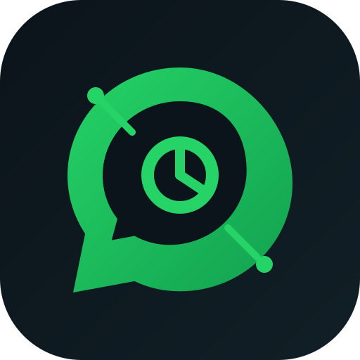

<p align="center">
  
</p>

<h1 align="center">OxideZap</h1>

<p align="center">
  <strong>A lightweight, native WhatsApp Web desktop client for Linux, built with Rust and GPUI.</strong>
</p>

<p align="center">
  <a href="https://github.com/artur282/oxidezap/actions/workflows/ci.yml"></a>
  <a href="https://github.com/artur282/oxidezap/releases/latest"></a>
  <a href="LICENSE"></a>
  
  
</p>

> **Unofficial, independent project.** OxideZap is not affiliated with, endorsed by, or sponsored by WhatsApp or Meta. It loads the official [`web.whatsapp.com`](https://web.whatsapp.com) interface in the system WebKitGTK engine and wraps it in a native Rust shell.

## What is OxideZap?

OxideZap is an open-source **WhatsApp Web desktop client for Linux**. It gives WhatsApp Web the desktop conveniences a browser tab cannot offer: a system tray, native notifications, multiple isolated accounts, an application lock, a global show/hide shortcut, and a native settings window.

The native shell is written in **Rust** and rendered with **[GPUI](https://gpui.rs)**, the GPU-accelerated UI framework behind [Zed](https://zed.dev). The WhatsApp Web page itself runs in **WebKitGTK**, the web engine already shipped by most Linux distributions. There is no Electron, no bundled Chromium, and no Node.js runtime.

OxideZap is early-stage software. Version 0.1.0 implements the features described below, but the project is still young and Linux with X11 or XWayland is the only supported platform.

## Why GPUI?

Tauri is a webview wrapper: the application UI is HTML/CSS/JS rendered by the same webview that renders the page. OxideZap takes a different route. The application chrome -- titlebar, settings, lock screen, tray menu, notifications -- is **native GPUI**, drawn by the GPU. Only the WhatsApp Web content area is a webview.

That split matters:

- The native shell is **small and fast**, and it does not ship a second browser engine.
- The UI is **real Rust**, not a web page pretending to be a desktop app.
- The webview is isolated to the content area, so a WhatsApp Web update cannot break the native chrome.
- GPUI provides GPU-accelerated rendering, a modern layout model, and a single Rust codebase.

## Features

### Accounts

- **Multiple WhatsApp accounts at once.** Each account gets its own GPUI window and its own WebKit data store (cookies, local storage, IndexedDB, caches) under `~/.local/share/oxidezap/accounts/<uuid>/`.
- **Add, rename, remove, and open accounts** from the native settings window.
- **Persistent login.** Scan the QR code once and stay signed in across restarts.
- **Per-account unread counts**, notifications, and tray entries.
- **Remembered window bounds** per account.

### Native shell

- **Custom GPUI titlebar** with the account name, unread badge, settings, lock, minimize, maximize, and close controls, plus drag and edge-resize support.
- **Clipboard file paste.** Copy a file, photo, or video in the file manager and press `Ctrl+V` in a chat: OxideZap injects it into WhatsApp's attachment flow. Files over 64 MB should use the attach button.
- **Settings window** with Accounts, Appearance, Notifications, General, Security, and About sections.
- **Themes**: System, Light, and Dark for the native shell.
- **WhatsApp zoom** from 80% to 150%.
- **Notification toggle** in Settings.
- **Close to tray**, **launch at login**, **remember bounds**, and a **configurable global shortcut**.
- **App lock** with an Argon2id password. Lock on launch, on hide, or after an idle timeout; lock now from the tray or Settings; reset the password from Settings. The lock window hides every account window until the password is verified.

### Desktop integration

- **System tray** through StatusNotifierItem, with show/hide, account list, add account, settings, lock, and quit.
- **Unread badge** in the tray tooltip and, on supported desktops, on the launcher icon through the Unity LauncherEntry D-Bus interface.
- **Native notifications** for new messages, with sender and message preview.
- **Single instance** through a Unix socket. Launching OxideZap again forwards the request to the running instance.
- **Global show/hide shortcut** through X11 `XGrabKey`, default `Ctrl+Shift+W`, configurable in Settings. This is X11/XWayland-only.
- **Launch at login** through an XDG autostart entry at `~/.config/autostart/oxidezap.desktop`.
- **Link handling.** External `http(s)`, `mailto:`, and `tel:` links open in the system browser or application. `wa.me`, `chat.whatsapp.com`, and `web.whatsapp.com` links stay inside OxideZap. WhatsApp's internal `whatsapp.net` utility pages (such as the Flows cache manager) stay in the webview and never open a system browser tab. `whatsapp://` URLs are translated to their WhatsApp Web equivalents.
- **Downloads** go to `~/Downloads` and produce a native notification with the destination.
- **CLI control** with `--toggle`, `--lock`, and `--quit`, plus URL forwarding to a running instance.

## Requirements

| Component | Requirement |
| --- | --- |
| OS | Linux with X11 or XWayland |
| WebKitGTK | `webkit2gtk-4.1` **>= 2.46.1** (older versions can hang WhatsApp's QR login) |
| GTK | GTK 3 |
| GPU | Vulkan-capable GPU and driver (GPUI uses Vulkan through Blade) |
| Rust | Stable, 1.85 or newer |

The tray requires a StatusNotifier host. Native notifications require a notification daemon. Voice and video calls, as well as voice-note recording, depend on WebKitGTK's WebRTC and portal support and may not work on every distribution.

### Debian, Ubuntu, and Linux Mint

On Ubuntu 24.04 or a compatible distribution:

```bash
sudo apt install build-essential pkg-config clang cmake ninja-build \
  libwebkit2gtk-4.1-dev libjavascriptcoregtk-4.1-dev libgtk-3-dev \
  libxkbcommon-dev libfontconfig1-dev libfreetype-dev libvulkan-dev \
  libx11-dev libxcb1-dev libwayland-dev libssl-dev \
  mesa-vulkan-drivers
```

On other distributions, install the equivalent WebKitGTK 4.1, GTK 3, X11, XCB, Vulkan, fontconfig, FreeType, and OpenSSL development packages.

## Build from source

```bash
git clone https://github.com/artur282/oxidezap.git
cd oxidezap
cargo build --release
./target/release/oxidezap
```

The release binary is `target/release/oxidezap`. The first build compiles GPUI, WebKitGTK bindings, and the rest of the dependency tree, so it can take several minutes.

For a faster development loop:

```bash
cargo run
```

## Install

The installer is user-local and does not require root:

```bash
./install.sh
```

It installs:

- the binary to `~/.local/bin/oxidezap`;
- the desktop entry to `~/.local/share/applications/oxidezap.desktop`;
- the icon to `~/.local/share/icons/hicolor/scalable/apps/oxidezap.svg`;
- AppStream metadata to `~/.local/share/metainfo/`;
- the `whatsapp://` URL handler.

If `target/release/oxidezap` does not exist, the installer builds it with `cargo build --release`. Set `PREFIX` to install somewhere else:

```bash
PREFIX="$HOME/.local" ./install.sh
```

The script never invokes `sudo`. If you install into a system prefix such as `/usr/local`, run it with the permissions that prefix requires.

To remove the installed files without deleting your accounts or settings:

```bash
./install.sh --uninstall
```

### Manual install

```bash
install -Dm755 target/release/oxidezap ~/.local/bin/oxidezap
install -Dm644 assets/oxidezap.svg \
  ~/.local/share/icons/hicolor/scalable/apps/oxidezap.svg
install -Dm644 packaging/oxidezap.desktop \
  ~/.local/share/applications/oxidezap.desktop
```

The packaged desktop entry uses `Exec=oxidezap %u`, so `~/.local/bin` must be in your `PATH`. The installer rewrites it to an absolute path instead. After a manual install, register the URL handler and refresh the desktop database:

```bash
xdg-mime default oxidezap.desktop x-scheme-handler/whatsapp
update-desktop-database ~/.local/share/applications
```

## Usage

| Action | How |
| --- | --- |
| Start OxideZap | `oxidezap` |
| Show or hide | Tray icon, or `Ctrl+Shift+W` |
| Add an account | Settings -> Accounts -> **Add account** |
| Switch accounts | Open the account from the tray or from Settings -> Accounts |
| Open settings | Titlebar gear, or tray -> **Settings** |
| Lock the app | Tray -> **Lock now**, or Settings -> Security -> **Lock now** |
| Change WhatsApp zoom | Settings -> Appearance -> Display size |
| Quit | Tray -> **Quit**, or `oxidezap --quit` |
| Open a chat link | `oxidezap "whatsapp://send?phone=..."` |

### Command line

```text
Usage: oxidezap [OPTIONS] [URL]

Options:
  --toggle        Show or hide the running instance
  --lock          Lock the running instance
  --quit          Quit the running instance
  --autostart     Start hidden when launched at login
  --smoke-test    Run the X11/WebKit overlay smoke test and exit
  -h, --help      Print help
  -V, --version   Print the version

URLs: whatsapp://send?phone=..., https://wa.me/..., https://chat.whatsapp.com/...
```

`--smoke-test` starts the application under X11 with a local HTML page, verifies that the GPUI window and the WebKit transient overlay have the expected geometry, prints `SMOKE OK`, and exits with status 0.

## Configuration

| Path | Purpose |
| --- | --- |
| `~/.config/oxidezap/settings.json` | Accounts, appearance, notifications, general, and security settings |
| `~/.local/share/oxidezap/accounts/<uuid>/` | Per-account WebKit data (`data/`) and cache (`cache/`) |
| `~/.cache/oxidezap/` | Runtime assets such as the tray icon |
| `~/.config/autostart/oxidezap.desktop` | Autostart entry, created when launch at login is enabled |
| `$XDG_RUNTIME_DIR/oxidezap-<uid>.sock` | Single-instance socket |
| `~/Downloads` | Default download directory |

OxideZap follows `XDG_CONFIG_HOME`, `XDG_DATA_HOME`, `XDG_CACHE_HOME`, and `XDG_RUNTIME_DIR` when they are set. Removing an account from Settings also removes its WebKit profile directory.

## Architecture

OxideZap runs a GPUI shell and a separate GTK/WebKit thread in one process. The GPUI window is the real application window: it owns the taskbar entry, the custom titlebar, and all native chrome. A borderless GTK `Toplevel` containing the `WebKitWebView` is positioned over the GPUI content area.

```text
GPUI window (taskbar entry)
+-------------------------------------------------+
| custom titlebar (GPUI)                          |
+-------------------------------------------------+
|                                                 |
|   GTK transient overlay                         |
|   WebKitGTK + https://web.whatsapp.com          |
|                                                 |
+-------------------------------------------------+

  WM_TRANSIENT_FOR = GPUI XID
  skip_taskbar, skip_pager
  geometry synchronized every 100 ms
```

- **GPUI** owns the native shell, settings window, lock window, tray, notifications, global shortcut, and the main event loop.
- **WebKitGTK** owns the WhatsApp Web page on a dedicated thread with its own GLib loop.
- The GTK window is a **borderless transient** of the GPUI window (`WM_TRANSIENT_FOR`) with `skip_taskbar` and `skip_pager` set. It is positioned below the 42 px GPUI titlebar and resized to match the GPUI content area, with a 4 px inset so the GPUI edge-resize handles remain reachable.
- The overlay geometry is synchronized **every 100 ms** by reading the GPUI window geometry over X11 and moving or resizing the GTK window when it drifts.
- **X11 reparenting is not used.** Probes showed that GPUI child windows and reparented GTK windows do not render. The transient-overlay approach is the supported design. If the overlay cannot be positioned, OxideZap logs the exact X11 error and keeps the GTK window detached instead of crashing.
- **Accounts are isolated** with separate `WebKitWebsiteDataManager` data and cache directories.
- On a Wayland session the application runs through **XWayland**, because embedding a foreign GTK surface into a Wayland client is not portable. Native Wayland support is on the roadmap.

The two threads communicate over channels. The GPUI side sends commands such as create, show, hide, load, zoom, reload, and quit; the WebKit side reports ready state, load state, titles (from which unread counts are derived), notifications, downloads, external links, and crashes.

## Security and privacy

- OxideZap is an **unofficial client**. It is not affiliated with WhatsApp or Meta.
- The application loads the official `https://web.whatsapp.com` page. Your session, messages, and encryption keys are handled by WhatsApp Web inside WebKitGTK.
- Account data stays on your machine under `~/.local/share/oxidezap/`. OxideZap does not run a server and does not include telemetry or analytics.
- The optional app lock hashes the password with **Argon2id** and verifies it locally. The lock protects access to the running UI; it does not encrypt the WebKit profile on disk.
- Notifications show the sender and message preview. You can disable them in Settings.

## Limitations

- **X11 or XWayland only.** Native Wayland is not implemented. On Wayland sessions the application relies on XWayland.
- **The global shortcut uses X11 `XGrabKey`.** It does not work on a pure Wayland session and can conflict with shortcuts registered by the desktop environment.
- **WhatsApp Web dominates memory use.** OxideZap keeps the native shell small, not the web content.
- **Calls and voice notes** depend on WebKitGTK's WebRTC support and on the desktop portal configuration. They are not guaranteed on every distribution.
- **Notifications** require a notification daemon. **The tray** requires a StatusNotifier host; desktops without one will not show the tray icon.
- **The first login requires a QR scan** from the WhatsApp mobile app.
- **No auto-update.** Reinstall or replace the binary to update.
- **The app lock does not encrypt data at rest.** It gates the UI, not the files on disk.
- **Linux only.** There are no macOS or Windows builds.

## Development

Before opening a pull request, run:

```bash
cargo fmt --all -- --check
cargo clippy --all-targets -- -D warnings
cargo test
```

Run the X11/WebKit integration smoke test on a real X11 display:

```bash
DISPLAY=:0 cargo run -- --smoke-test
```

The smoke test prints `SMOKE OK` and exits with status 0 when the GPUI window and the WebKit transient overlay are positioned correctly. It needs a Vulkan-capable display; Xvfb does not provide the DRI3 support GPUI needs for presentation. CI runs formatting, Clippy, unit tests, and a release build on Ubuntu 24.04; the smoke test is a local check.

## Roadmap

- [x] v0.1.0: GPUI shell, WebKitGTK overlay, multi-account support, tray, notifications, app lock, settings, CLI, installer, and CI
- [ ] Native Wayland support without XWayland
- [ ] Distribution packaging and broader desktop integration

## Contributing

Issues and pull requests are welcome. For larger changes, open an issue first so the approach can be discussed. Please run the formatting, Clippy, and test commands above before submitting a pull request.

## License

MIT. See [LICENSE](LICENSE).
